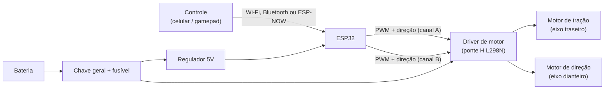

# Mecânica 

Documentação técnica do carro 


## Índice

1. [Objetivo e requisitos](#1-objetivo-e-requisitos)
2. [Arquitetura geral](#2-arquitetura-geral)
3. [Dimensões e massa](#3-dimensões-e-massa)
4. [Tração](#4-tração)
5. [Direção](#5-direção)
6. [Eletrônica e alimentação](#6-eletrônica-e-alimentação)
7. [Peças projetadas e modificadas](#7-peças-projetadas-e-modificadas)
8. [Decisões de projeto](#8-decisões-de-projeto)
9. [Riscos e pendências](#9-riscos-e-pendências)
10. [Plano de testes](#10-plano-de-testes)
11. [Lista de materiais (BOM)](#11-lista-de-materiais-bom)

---

## 1. Objetivo e requisitos

Adaptar um carro RC comercial para ser controlado por ESP32 e disputar uma corrida.

| Requisito | Meta |
|---|---|
| Velocidade em reta | A maior possível, mantendo a mecânica original |
| Aceleração | Sair da curva sem patinar |
| Estabilidade | Não capotar nem derrapar em curvas |
| Controle | Frente/ré proporcionais (PWM) e direção esquerda/direita pelo ESP32 |
| Confiabilidade | Completar todas as baterias da corrida sem queimar driver ou motor |
| Reversibilidade | Sempre que possível, adaptar sem cortar a carroceria nem a mecânica original |

## 2. Arquitetura geral



| Bloco | Função | Situação |
|---|---|---|
| Carro RC 1:18 (conversível) | Carroceria, chassi, rodas e mecânica de tração/direção | Comprado |
| Motor de tração | Motor DC com caixa de redução no eixo traseiro | Original do carro |
| Motor de direção | Motor DC na frente com retorno por mola (faz papel de servo) | Original do carro |
| Placa receptora original | Recebia o sinal do controle 27 MHz | **Removida e substituída** |
| Driver | Ponte H L298N (dois canais: tração e direção) | Existente |
| Controlador | ESP32 | Existente |
| Alimentação | Bateria de lítio (ver [seção 6](#6-eletrônica-e-alimentação)) | Existente / a definir |
| Controle remoto | Página no celular (Wi-Fi/WebSocket) ou app Bluetooth | Decidir |

## 3. Dimensões e massa

O carro é um modelo esportivo conversível, escala 1:18, com carroceria de plástico, aerofólio traseiro e cabine aberta.

| Item | Valor |
|---|---|
| Comprimento | 23,3 cm |
| Largura | 8,2 cm |
| Altura | 11,5 cm |
| Distância entre eixos | A medir |
| Bitola (largura entre rodas) | A medir |
| Diâmetro da roda | A medir |
| Largura do pneu | A medir |
| Massa original (com bateria original) | A medir |
| Massa final pronta para correr | A medir (meta: o mínimo possível) |
| Espaço interno livre para eletrônica (C × L × A) | A medir |

**Esboço mecânico:** vistas superior e lateral com a posição proposta de ESP32, driver, bateria, chave e motores (inserir a imagem em `docs/esboco-mecanico.png`). As cotas do esboço são preenchidas com as medidas reais:

- **C** = comprimento total
- **L** = largura total
- **E** = distância entre eixos
- **H** = altura

**Observação:** a bateria de 2 células (7,3 V) é mais pesada que a célula única original. Posicioná-la baixa e no centro do carro, entre os eixos, evita deslocar o centro de gravidade.

## 4. Tração

### 4.1 Especificação do motor

Os motores são os originais do carro e **ainda não têm especificação**. Preencher medindo na bancada:

| Parâmetro | Valor |
|---|---|
| Tensão nominal | A confirmar (motores de brinquedo costumam ser 3-6 V) |
| Velocidade sem carga | A medir |
| Corrente sem carga | A medir |
| Corrente com rotor bloqueado (stall) | A medir |
| Relação de redução da caixa | A contar (dentes das engrenagens) |

### 4.2 Velocidade teórica e real

Fórmula: `v = RPM da roda × π × D ÷ 60`, com `D` em metros.

A velocidade real é medida em pista:

```
v = distância (m) ÷ tempo (s)
```

Marcar 5 m em linha reta, cronometrar em cada marcha de PWM (baixa, média, alta) e registrar na tabela de testes (seção 10).

### 4.3 Quantos motores

O carro tem **1 motor de tração**, no eixo traseiro, e a tração é traseira.

| Característica | Efeito |
|---|---|
| Tração só atrás | Carro leve e simples, mas pode patinar na arrancada |
| Um único motor de tração | Consumo baixo; velocidade máxima limitada pela redução original |
| Motor de direção separado | Direção independente da tração, sem arrastar rodas nas curvas |

Trocar a redução ou o motor só entra em consideração se a velocidade medida (seção 10) for insuficiente.

### 4.4 Ponto de atenção: motor de eixo único e caixa de redução

O motor de tração aciona as duas rodas traseiras por um eixo comum (normalmente com diferencial). Por isso o carro **faz curva pela direção dianteira**, e não por diferencial. A ponte H só precisa controlar sentido e velocidade do motor de tração.

## 5. Direção

O motor de direção não é um servo. Em carros RC desse tipo, ele costuma ser um **motor DC pequeno com retorno por mola**: ao receber tensão, empurra as rodas para um lado até o fim do curso, e a mola centraliza quando a tensão cai. Isso precisa ser confirmado ao abrir o carro.

| Característica | Consequência |
|---|---|
| Sem sensor de posição | O ESP32 não sabe o ângulo, só comanda esquerda/centro/direita |
| Curso limitado por batente mecânico | Mantendo tensão no fim do curso, o motor trava e a corrente de stall aquece driver e motor |
| Retorno por mola | O centro é obtido soltando o comando, sem precisar de tensão |

Estratégia de controle:

- Esquerda e direita são dois estados (ON por sentido); centro é motor desligado.
- Se o motor suportar, usar PWM reduzido para suavizar o esterçamento e limitar a corrente em trava.
- Limitar o tempo contínuo de comando no fim do curso.
- Como o ângulo não é medido, a direção é aproximadamente proporcional no máximo: o PWM varia a força do esterçamento, mas não garante um ângulo específico.

## 6. Eletrônica e alimentação

| Item | Detalhe |
|---|---|
| Canal A do L298N | Motor de tração (traseiro) |
| Canal B do L298N | Motor de direção (dianteiro) |
| Controle | PWM nos pinos ENA/ENB; sentido nos pinos IN1-IN4 |
| Chave geral | Na linha positiva da bateria, antes do driver |
| Fusível | Em série com a bateria |
| Regulador 5 V | Alimenta o ESP32 a partir da bateria |
| Capacitores | 100 nF entre os terminais de cada motor, para reduzir ruído |

A tensão da bateria define o que chega aos motores. A queda interna do L298N é de cerca de 2 V:

| Bateria | Tensão no motor (aprox.) | Avaliação |
|---|---|---|
| 1 célula (3,7 V, original) | ~1,7 V | Fraca demais para o motor |
| 2 células em série (7,3-7,4 V) | ~5,3-5,4 V | Compatível com motores de 3-6 V; confirmar tensão do motor |

Se a queda do L298N se mostrar um problema, avaliar um driver mais eficiente (por exemplo TB6612FNG ou DRV8833).

## 7. Peças projetadas e modificadas

| Peça | Situação | Descrição |
|---|---|---|
| Carroceria e chassi do carro RC | Existente | Estrutura mecânica reaproveitada |
| Placa receptora original | Removida | Substituída por ESP32 + L298N |
| Suporte do ESP32 e do driver | Proposta | Fixar no espaço interno, longe dos motores |
| Suporte da bateria | Proposta | Fixar baixo e no centro do carro |
| Chave liga/desliga | Proposta | Acessível por baixo ou pela lateral, sem desmontar o carro |
| Fiação dos motores | Modificada | Fios originais religados ao L298N |
| Rodas e pneus | Existentes | Manter as originais; avaliar mudança só se patinar |
| Redução do motor de tração | Existente | Manter; trocar apenas se a velocidade medida for baixa |

## 8. Decisões de projeto

| Nº | Decisão | Situação | Justificativa |
|---|---|---|---|
| D1 | Usar carro RC pronto no lugar do chassi 4WD de acrílico | Adotada | Mecânica de direção já montada; menos peças para projetar |
| D2 | 2 motores originais (tração traseira + direção dianteira) | Adotada | Configuração nativa do carro |
| D3 | Direção pelo motor original com retorno por mola | Adotada | Substitui o servo previsto no projeto anterior |
| D4 | Bateria 1 célula vs 2 células em série | Em aberto (recomendado: 2 células) | Com L298N a bateria de 1 célula não entrega tensão suficiente |
| D5 | Driver L298N vs driver mais eficiente | Em aberto | Decidir após medir a tensão que chega ao motor |
| D6 | Protocolo de controle (Wi-Fi/WebSocket, Bluetooth ou ESP-NOW) | Em aberto | Avaliar alcance e latência em pista |
| D7 | Trocar a redução do motor de tração | Em aberto | Só se a velocidade medida for insuficiente |

## 9. Riscos e pendências

| Risco | Impacto | Mitigação |
|---|---|---|
| Danificar a carroceria ou a mecânica ao abrir o carro | Perda do carro | Fotografar cada etapa e guardar parafusos por posição |
| Motor de direção travado no fim do curso | Aquecimento e queima de driver ou motor | Limitar tempo de comando e PWM; medir corrente em stall |
| Queda de tensão no L298N | Motor fraco | Usar 2 células ou trocar de driver |
| Reset do ESP32 por ruído ou queda de tensão (brownout) | Carro para ou perde o controle | Capacitores nos motores, regulador estável e fios curtos |
| Patinagem na arrancada (tração traseira) | Perde tempo | Rampa de aceleração e pneu com mais aderência |
| Bateria mais pesada que a original | Centro de gravidade alto | Fixar baixa e no centro |
| Perda de sinal na pista | Carro descontrolado | Failsafe (parar após perder comando) e teste em distância real |
| Sem especificação dos motores originais | Dimensionamento incerto | Medir tensão, corrente e rotação na bancada (seção 4.1) |

## 10. Plano de testes

| Teste | O que verificar | Resultado |
|---|---|---|
| 1. Bancada: motor de tração | Tensão nominal, corrente sem carga e em stall | A preencher |
| 2. Bancada: motor de direção | Sentido, curso total e corrente em trava | A preencher |
| 3. Direção | Esquerda, centro e direita pelo ESP32; retorno pela mola | A preencher |
| 4. Reta de 5 m | Tempo nas marchas baixa, média e alta | A preencher |
| 5. Curva | Estabilidade, raio mínimo e derrapagem | A preencher |
| 6. Aquecimento | Temperatura do L298N e dos motores após uma bateria | A preencher |
| 7. Failsafe | Carro para ao perder o sinal a distância real | A preencher |
| 8. Autonomia | Número de baterias da corrida sem falha | A preencher |

## 11. Lista de materiais (BOM)

| Item | Qtd | Situação |
|---|---|---|
| Carro RC conversível 1:18 com controle (original) | 1 | Comprado |
| ESP32 DevKit | 1 | Existente |
| Driver ponte H L298N | 1 | Existente |
| Baterias de lítio 18650 | 2 | Existentes |
| Suporte para 2 baterias 18650 | 1 | A confirmar |
| Chave liga/desliga | 1 | A adquirir |
| Fusível e porta-fusível | 1 | A adquirir |
| Regulador 5 V (buck) | 1 | A adquirir |
| Capacitores 100 nF | 2 | A adquirir |
| Fios, conectores e abraçadeiras | - | A adquirir |
| Fita dupla-face ou velcro para fixação | - | A adquirir |
