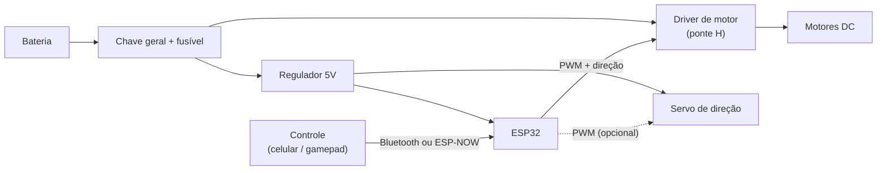

Documentação técnica do carro controlado por ESP32.

**Versão:** 1 · **Data:** 10/10/2026

> **Como ler:** itens marcados com **[MEDIR]** são estimativas baseadas em kits de chassi 4WD de acrílico parecidos com o nosso e precisam ser confirmados com régua, balança e multímetro. Itens marcados com **[DECIDIR]** ainda estão em aberto na equipe.

## Índice

1. [Objetivo e requisitos](#1-objetivo-e-requisitos)
2. [Arquitetura geral](#2-arquitetura-geral)
3. [Dimensões e massa](#3-dimensões-e-massa)
4. [Tração](#4-tração)
5. [Direção](#5-direção)
6. [Eletrônica e alimentação](#6-eletrônica-e-alimentação)
7. [Peças projetadas e modificadas](#7-peças-projetadas-e-modificadas)
8. [Decisões de projeto](#8-decisões-de-projeto)
9. [Riscos e pendências](#9-riscos-e-pendências)
10. [Plano de testes](#10-plano-de-testes)
11. [Lista de materiais (BOM)](#11-lista-de-materiais-bom)

---

## 1. Objetivo e requisitos

Construir um carro RC controlado por ESP32 para disputar uma corrida em uma pista com curvas.
| Requisito | Meta |
|---|---|
| Velocidade máxima em reta | O maior possível dentro das regras da prova |
| Aceleração | Sair da curva sem patinar |
| Estabilidade | Não capotar nem derrapar em curvas |
| Controle | Baixa latência, sem perder sinal na pista |
| Confiabilidade | Completar todas as baterias da corrida sem queimar driver ou motor |
| Regras da prova | Conferir limite de tensão, peso, dimensões e tipo de direção **[DECIDIR]** |

## 2. Arquitetura geral

| Bloco | Função | Situação |
|---|---|---|
| Chassi | Estrutura de acrílico de 2 andares com furos de fixação | Kit existente |
| Motores | Motores DC com redução 1:48, eixo duplo, 3-6V | Existentes |
| Driver | Ponte H L298N (ponto de partida) | Existente; troca avaliada |
| Controlador | ESP32 | Existente |
| Alimentação | Bateria 12V citada no projeto | Conflito com motores de 3-6V, ver [seção 6](#6-eletrônica-e-alimentação) |
| Controle remoto | App Bluetooth ou gamepad | **[DECIDIR]** |

## 3. Dimensões e massa

O chassi é o formato clássico de kit 4WD com duas placas de acrílico sobrepostas. Valores típicos desse tipo de kit:

| Item | Valor típico | Medida real |
|---|---|---|
| Comprimento | ~22 cm | **[MEDIR]** |
| Largura | ~15 cm | **[MEDIR]** |
| Altura (com 2 andares) | ~8-10 cm | **[MEDIR]** |
| Diâmetro da roda | ~65 mm | **[MEDIR]** |
| Largura do pneu | ~26 mm | **[MEDIR]** |
| Distância entre eixos | ~11-12 cm | **[MEDIR]** |
| Massa de cada motor | 30 g (especificação) | ok |
| Massa total pronta para correr | meta: o mínimo possível | **[MEDIR]** |

**Observação:** a segunda placa de acrílico (andar de cima) aumenta o peso e o centro de gravidade. Se o regulamento e a fixação permitirem, remover ou recortar o andar superior é a modificação mais barata para ganhar velocidade e estabilidade.

## 4. Tração

### 4.1 Especificação do motor

| Parâmetro | 3V | 6V |
|---|---|---|
| Velocidade sem carga | 90 RPM | 200 RPM |
| Corrente sem carga | ~150 mA | ~200 mA |
| Redução | 1:48 | 1:48 |
| Eixo | Duplo | Duplo |

### 4.2 Velocidade teórica

Fórmula: `v = RPM × π × D ÷ 60`. Com roda de 65 mm (perímetro ≈ 0,204 m):

| Cenário | RPM | Velocidade teórica |
|---|---|---|
| Motor atual a 3V | 90 | ≈ 0,31 m/s (1,1 km/h) |
| Motor atual a 6V | 200 | ≈ 0,68 m/s (2,4 km/h) |
| Mesmo motor com redução ~1:20 a 6V (estimativa) | ~480 | ≈ 1,6 m/s (5,9 km/h) |
| Mesmo motor com redução ~1:10 a 6V (estimativa) | ~960 | ≈ 3,3 m/s (11,8 km/h) |

Em carga a velocidade real fica abaixo desses valores. **Conclusão:** com redução 1:48 o carro é muito lento para corrida, e o maior ganho possível vem de trocar a redução, não de adicionar motores.

### 4.3 Quantos motores

| Configuração | Vantagens | Desvantagens |
|---|---|---|
| 4 motores (um por roda) | Mais torque e tração nas quatro rodas | +60 g de motores, mais corrente (cada canal do L298N alimenta 2 motores em paralelo), mais fios |
| 2 motores (um por roda traseira) | Carro mais leve, menor consumo, mesma velocidade máxima | Menos torque; tração só atrás |

**Recomendação:** 2 motores, com a economia de peso e corrente investida em motores de menor redução. **[DECIDIR]** na equipe.

### 4.4 Ponto de atenção: motores de eixo duplo

Com motor de eixo duplo, a montagem muda o que o carro consegue fazer:

- Se cada motor aciona as **duas rodas do mesmo eixo** (esquerda e direita), as rodas giram juntas e o carro **não consegue fazer curva por diferencial**. Precisa de direção por servo.
- Se há **um motor por roda** ou cada motor aciona as rodas de um mesmo lado, a direção por diferencial é possível.

Confirmar qual é a montagem real do carro **[DECIDIR]**.

## 5. Direção

O chassi não tem eixo direcional: as quatro rodas são fixas. As duas opções são:

| Opção | Como funciona | Prós | Contras |
|---|---|---|---|
| A. Diferencial (skid steering) | Lado esquerdo e direito com velocidades diferentes | Já funciona no chassi atual, simples de programar | Arrasta as rodas nas curvas, perde velocidade, desgasta o pneu |
| B. Servo na frente (Ackermann simplificado) | Servo gira as rodas dianteiras; motores atrás | Curvas mais rápidas e estáveis, melhor para pista | Exige projetar peça de direção e eixo dianteiro (chassi novo ou adaptado) |

**Recomendação:** opção B para corrida em pista com curvas. Se o prazo for curto, começar com A e evoluir para B.

## 6. Eletrônica e alimentação

### 6.1 Componentes

| Componente | Especificação | Observação |
|---|---|---|
| Microcontrolador | ESP32 | PWM nativo (LEDC), Bluetooth e Wi-Fi |
| Driver atual | L298N | ~2 A por canal; perda de ~2 V |
| Driver alternativo | TB6612FNG ou DRV8833 | MOSFET, menos perda e menos calor |
| Bateria | 2S Li-ion/LiPo 7,4V (proposta) | Substitui os 12V |
| Regulador | 5V (buck ou o do próprio módulo) | Para ESP32 e servo |

### 6.2 Tensão: risco principal

Os motores são nominalmente de 3-6V. Uma bateria de 12V ligada direto no driver tende a queimar ou encurtar muito a vida deles. Com 2S (7,4V) e o L298N, sobram cerca de 5,5V no motor, dentro da faixa. Com driver MOSFET sobra mais tensão, então é preciso limitar o PWM para não passar de ~6-7V no motor.

### 6.3 Corrente

- Corrente sem carga: ~200 mA por motor a 6V.
- Corrente de stall: **[MEDIR]** (travar o eixo por 1-2 s com multímetro em série).
- Regra: o driver deve suportar pelo menos 2x a corrente de stall, ou o PWM precisa ser limitado em software.

### 6.4 Software (ESP32)

- PWM em 20 kHz para evitar apito dos motores (uso do LEDC).
- Rampa de aceleração (soft start) para não patinar na arrancada.
- Freio ativo: terminais do motor em curto pela ponte H ao soltar o acelerador.
- Failsafe: se perder o sinal por mais de ~300 ms, parar os motores.

## 7. Peças projetadas e modificadas

| Peça | Situação | Descrição |
|---|---|---|
| Chassi de acrílico 2 andares | Existente (kit) | Base do carro; furos para fixar motores e placas |
| Andar superior | Proposta | Remover ou recortar para reduzir peso e centro de gravidade |
| Suporte da bateria | Proposta | Fixar baixo e no centro do carro |
| Suporte do ESP32 e driver | A definir | Fixação com espaçadores nos furos do chassi |
| Direção dianteira (servo) | Proposta | Peça nova (impressão 3D ou acrílico) com servo e manga de eixo |
| Rodas e pneus | Existentes (~65 mm) | Avaliar rodas maiores ou pneus de borracha mais macia |
| Redução dos motores | Proposta | Trocar por motor com redução 1:10 a 1:20 |
| Chave geral e fusível | Proposta | Proteção do circuito e desligamento rápido |

## 8. Decisões de projeto

| Nº | Decisão | Situação | Justificativa |
|---|---|---|---|
| D1 | Usar chassi 4WD de acrílico | Adotada | Disponível, barato e fácil de modificar |
| D2 | ESP32 como controlador | Adotada | Já disponível, PWM e comunicação sem fio |
| D3 | 2 ou 4 motores | Em aberto (recomendado: 2) | Mesma velocidade máxima, menos peso e consumo |
| D4 | Trocar redução 1:48 | Recomendada | Velocidade atual é muito baixa para corrida |
| D5 | Bateria 2S 7,4V no lugar de 12V | Recomendada | Compatível com motores de 3-6V |
| D6 | Trocar L298N por MOSFET | Recomendada | Menos perda e calor |
| D7 | Direção por servo | Recomendada | Curvas mais rápidas que o diferencial |
| D8 | Controle sem fio | Em aberto | ESP-NOW ou gamepad têm menos latência que app por Wi-Fi |

## 9. Riscos e pendências

| Risco | Impacto | Mitigação |
|---|---|---|
| Tensão 12V nos motores 3-6V | Motor queimado | Usar 2S 7,4V e limitar PWM |
| Corrente de stall acima do limite do driver | Driver queimado | Medir stall e trocar driver se necessário |
| Regras da prova desconhecidas | Carro desclassificado | Ler o regulamento antes de comprar peças |
| Patinagem na arrancada | Perde tempo | Rampa de aceleração e pneu com mais aderência |
| Perda de sinal na pista | Carro descontrolado | Failsafe e teste em distância real |

## 10. Plano de testes

1. Pesar o carro pronto e medir as dimensões reais.
2. Medir corrente sem carga e de stall de cada motor.
3. Medir a tensão da bateria sob carga e a tensão real no motor.
4. Cronometrar 10 m em reta com a configuração atual e depois de cada modificação.
5. Cronometrar uma volta na pista de teste e comparar as configurações.
6. Testar o failsafe desligando o controle.

## 11. Lista de materiais (BOM)

| Item | Qtd | Situação |
|---|---|---|
| Chassi acrílico 4 rodas | 1 | Existente |
| ESP32 | 1 | Existente |
| Motor DC com redução (atual 1:48) | 2 ou 4 | Existente |
| Motor de menor redução | 2 | A comprar |
| Driver TB6612FNG | 1 | A comprar |
| Bateria 2S 7,4V | 1 | A comprar |
| Regulador buck 5V | 1 | A comprar |
| Servo SG90 (para direção) | 1 | A comprar |
| Chave geral e fusível | 1 | A comprar |
| Fios, espaçadores e parafusos | — | Existentes |
