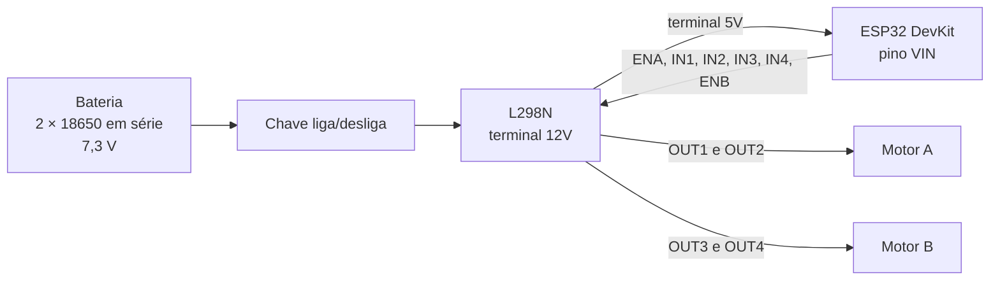

# Eletrônica 

Descrição do circuito elétrico e eletrônico do carro

Complementa o [README.md](README.md)

## Índice

1. [Visão geral](#1-visão-geral)
2. [Componentes](#2-componentes)
3. [Esquema elétrico](#3-esquema-elétrico)
4. [Alimentação](#4-alimentação)
5. [Chave liga/desliga](#5-chave-ligadesliga)
6. [Controle dos motores](#6-controle-dos-motores)
7. [Ligações entre ESP32 e L298N](#7-ligações-entre-esp32-e-l298n)
8. [Carregamento da bateria por USB-C](#8-carregamento-da-bateria-por-usb-c)
9. [Câmera em tempo real](#9-câmera-em-tempo-real)

---

## 1. Visão geral

O carro é controlado por um **ESP32**, que gera os sinais de controle para uma ponte H **L298N**, que por sua vez aciona os **2 motores DC**. Toda a energia vem de **2 baterias de lítio 18650 ligadas em série**, em um suporte (holder), com uma chave liga/desliga no fio positivo.

Além do circuito, o projeto prevê uma **câmera** para ver a imagem em tempo real.

## 2. Componentes

| Componente | Modelo / tipo | Função |
|---|---|---|
| Microcontrolador | ESP32 DevKit | Gera os sinais de controle (PWM e sentido) |
| Driver de motor | Ponte H L298N | Entrega a potência aos motores e gera os 5V |
| Motores | 2 motores DC, 3-6V, redução 1:48, eixo duplo | Tração do carro |
| Baterias | 2× 18650 de lítio em série (7,3 V) | Fonte de energia |
| Suporte | Holder para baterias 18650 | Fixação e ligação das baterias |
| Chave | Chave liga/desliga tipo gangorra | Liga e desliga o carro |
| Carregamento | Dispositivo de carga por USB-C | Recarrega a bateria de lítio |
| Câmera | ESP32-CAM ou outra câmera leve | Imagem em tempo real para pilotar |

### Motores

| Parâmetro | Valor |
|---|---|
| Tensão de operação | 3 a 6 V |
| Redução | 1:48 |
| Eixo | Duplo |
| Peso | 30 g |
| Corrente sem carga | ~200 mA (6 V) e ~150 mA (3 V) |
| Velocidade sem carga | 200 RPM (6 V) e 90 RPM (3 V) |

## 3. Esquema elétrico

O esquema foi feito no Fritzing.

O negativo da bateria, o GND do L298N e o GND do ESP32 são ligados entre si, formando o terra comum do circuito.

## 4. Alimentação

1. As duas baterias 18650 em série entregam **7,3 V**.
2. O positivo da bateria passa pela chave liga/desliga e chega ao terminal **12V** do L298N.
3. O L298N distribui essa tensão aos motores pelas saídas OUT1 a OUT4.
4. O terminal **5V** do L298N alimenta o ESP32 pelo pino **VIN**.

## 5. Controle dos motores

O L298N tem dois canais, e cada canal aciona um motor.

| Canal | Pinos de controle | Saída | Motor |
|---|---|---|---|
| A | ENA, IN1, IN2 | OUT1 e OUT2 | Motor A |
| B | ENB, IN3, IN4 | OUT3 e OUT4 | Motor B |

- **Velocidade:** o ESP32 envia um sinal PWM para ENA (motor A) e ENB (motor B). Quanto maior o ciclo ativo do PWM, maior a tensão média no motor e maior a velocidade.
- **Sentido de giro:** os pinos IN1/IN2 (motor A) e IN3/IN4 (motor B) definem o sentido. Um pino em nível alto e o outro em baixo faz o motor girar em um sentido; invertendo os níveis, ele gira no sentido contrário.
- **Parada e freio:** com os dois pinos IN do canal no mesmo nível, o motor para.

## 6. Ligações entre ESP32 e L298N

Leitura do esquema, na ordem dos fios do cabeçalho do L298N. A confirmar na montagem.

| Fio | ESP32 | L298N | Função |
|---|---|---|---|
| Cinza (de cima) | D25 | ENB | PWM do motor B |
| Laranja | D26 | IN4 | Sentido do motor B |
| Laranja | D27 | IN3 | Sentido do motor B |
| Azul | D14 | IN2 | Sentido do motor A |
| Azul | D12 | IN1 | Sentido do motor A |
| Cinza (de baixo) | D13 | ENA | PWM do motor A |

- Motor A: terminais OUT1 e OUT2.
- Motor B: terminais OUT3 e OUT4.

## 8. Câmera em tempo real

O carro terá uma câmera, para que o piloto veja a imagem em tempo real e controle o carro olhando a imagem.

| Item | Descrição |
|---|---|
| Câmera | ESP32-CAM ou outra câmera leve |
| Uso | Pilotar o carro olhando a imagem |
| Critério | Solução de baixo custo e baixo peso (o FPV analógico foi considerado caro) |
