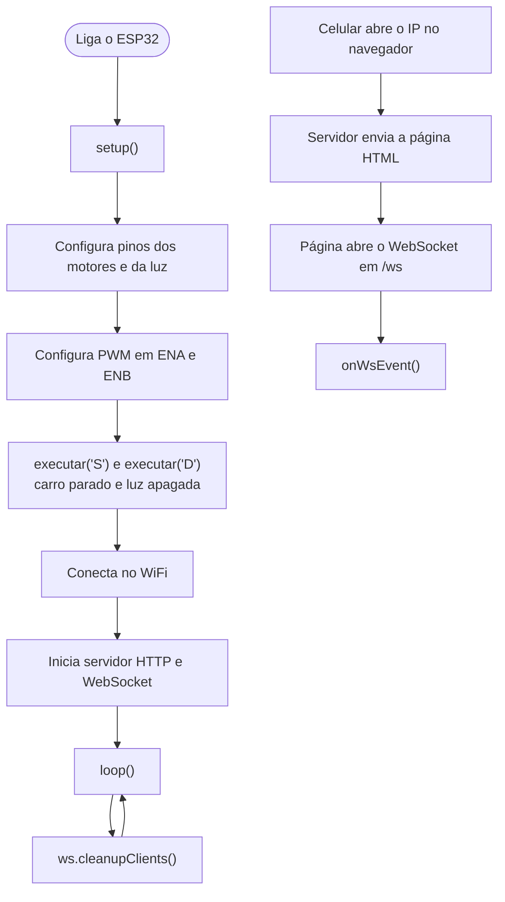
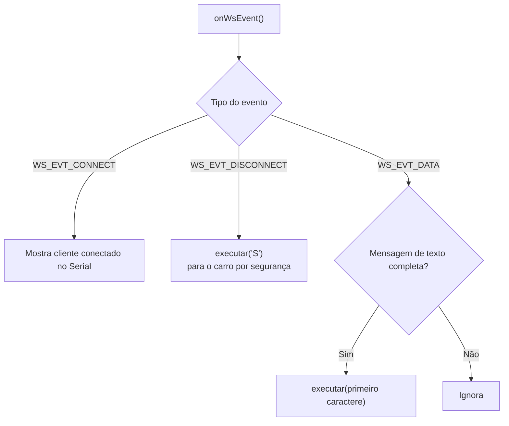

Documentação técnica do carro controlado por ESP32.

**Versão:** 1 · **Data:** 10/10/2026

## Índice

1. [Objetivo e requisitos](#1-objetivo-e-requisitos)
2. [Arquitetura geral](#2-arquitetura-geral)
3. [Código](#3-código-explicado)
4. [Riscos e pendências](#4-riscos-e-pendências)

---

## 1. Objetivo e requisitos

Construir um carro RC controlado por ESP32 para disputar uma corrida em uma pista com curvas.
| Requisito | Meta |
|---|---|
| Aceleração | Usar slider da web para controle |
| Direção | Não capotar nem derrapar em curvas |
| Vigilância | Baixa latência, sem perder sinal na pista |
| Confiabilidade | Consistencia nos testes do motor |
| Regras da prova | Conferir limite de tensão, peso, dimensões e tipo de direção **[DECIDIR]** |

## 2. Arquitetura geral

| Modulos | Descrição | Situação |
|---|---|---|
| Configuração WIFI | SSID | Funcionando |
| Direção | Servo motor | A fazer |
| Vigilância | Transcrição da imagem da ESPCAM | A fazer |
| HTTP | Canal de comunicação dupla sempre aberto | Funcionando + recursos são necessários|

## 3. Código explicado

### 3.1 Funções

| Parâmetro | Descrição | Situação |
|---|---|---|
| Câmera | Transcrição sem delay | A fazer |
| Motores | Responsável pela rotação para cada comando | OK |
| Servo | Responsável pela direção do eixo móvel | A fazer |
| HTTP | Vai ser o meio de comunicação adotado | OK |
| Setup | Precisa definir os pinos do ESP32, Estabelecer a comunicação e o estado inicial do carro | Parcial |
| Loop | Retoma as funções posteriores | Parcial |

### 3.2 Câmera

### 3.3 Motores

### 3.3 Servo

### 3.5. HTTP

Na função onWsEvent, acontece a abertura da comunicação, dando os dados no Serial do ESP32 para ser possivel conectar o celular com o ESP32 e oque acontece em cada situação da conexão.
Logo em seguida, está o HTML da página responsável pela interface de controle, ela faz referencia a algumas funções da aréa mecânica. Está secção do projeto está muito sujeita a alterações, pois o controle final será com um volante e a direção será feita por servos e ainda vai precisar comportar a camêra.

### 3.6. Setup

O setup é responsável por definir os pinos, logicamente, mas além disso, ele estabelece o estado de repouso inicial do carro, e a conexão WiFi do carro, inicializa o serial

## 4. Riscos e pendências

| Risco | Impacto | Mitigação |
|---|---|---|
| Delay da imagem do ESPCAM | Motor queimado | Reduzir a resolução ou usar rede WIFI com roteador local |
| Como alterar a velocidade sem usar joystick | Falta de controle nas curvas | Usar slider na Web |
| Regras da prova desconhecidas | Carro desclassificado | Ler o regulamento antes de comprar peças |
