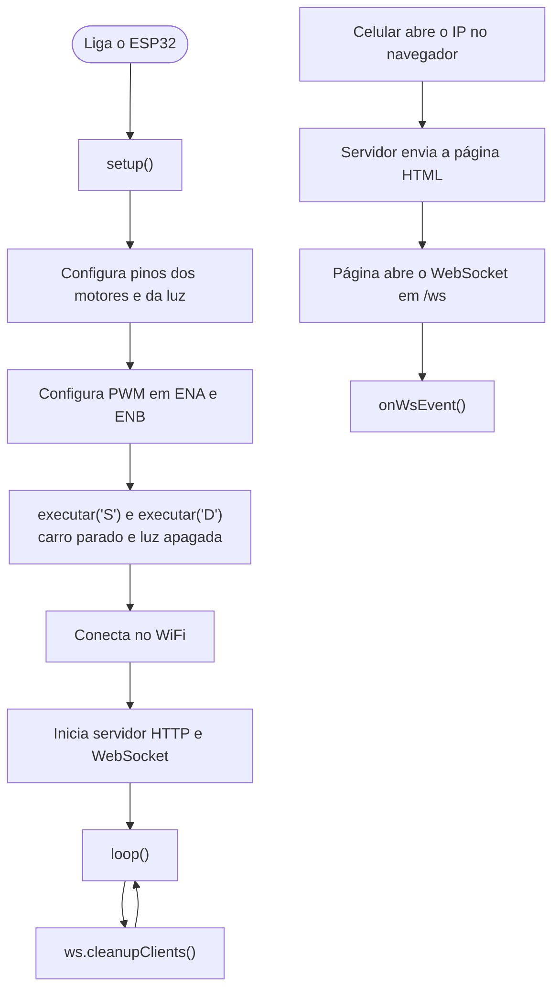
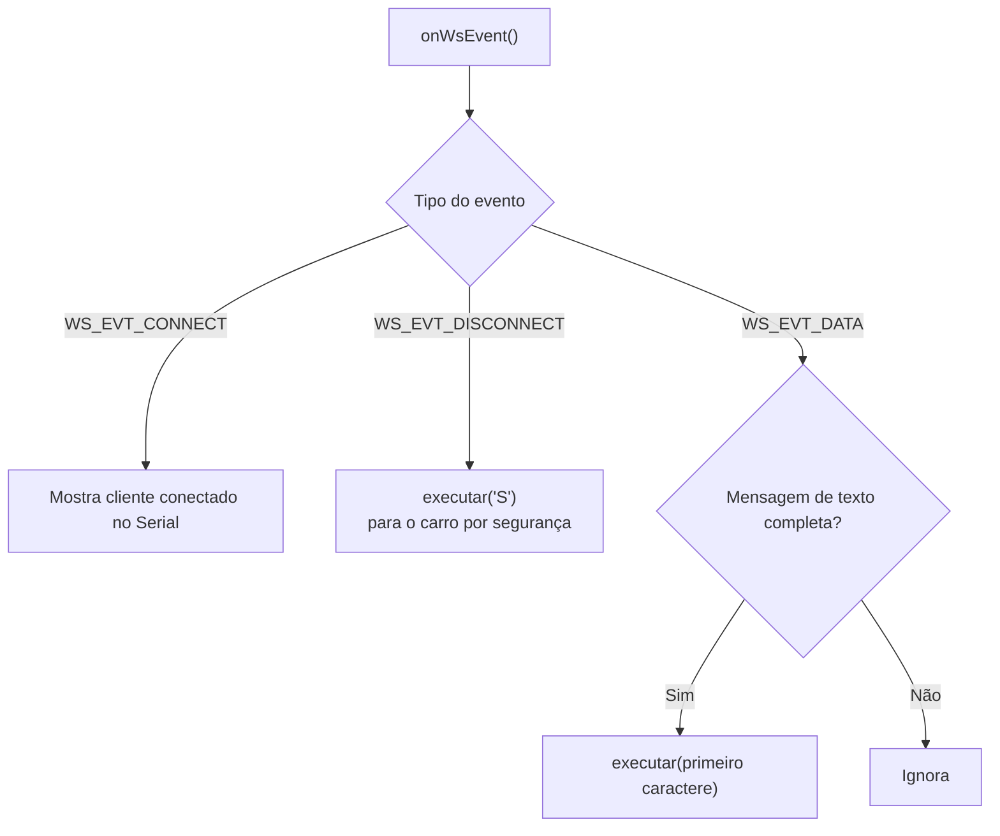
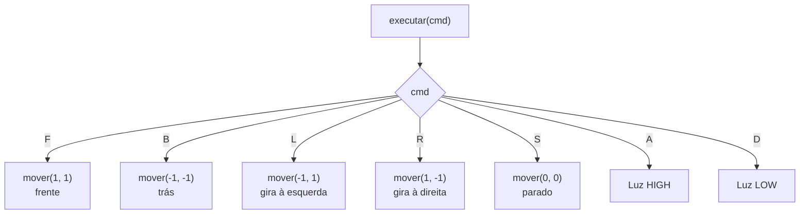
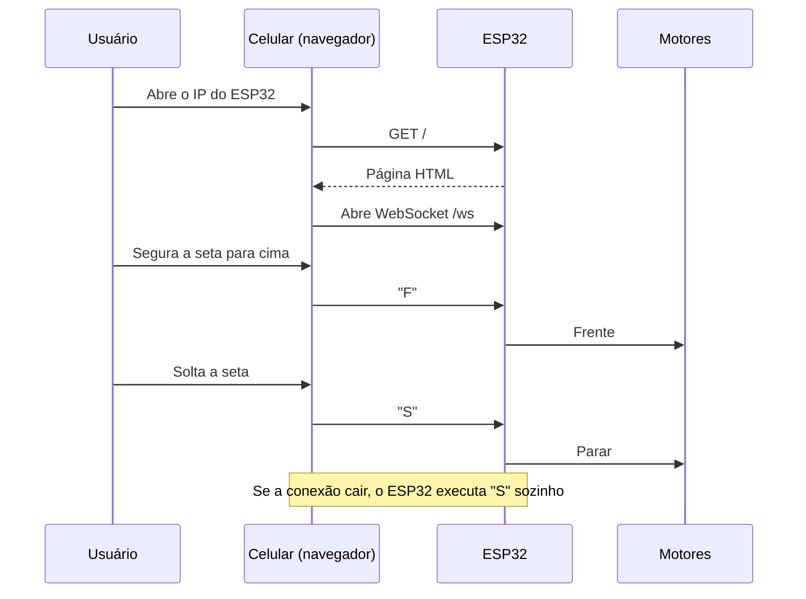

# Carrinho ESP32 controlado por WiFi

## Fluxo geral do programa

## Eventos do WebSocket

## Comandos

## Comunicação entre celular e ESP32

## Ligações dos pinos

| Sinal | GPIO | Função |
|---|---|---|
| ENA | 33 | Velocidade do motor direito (PWM) |
| IN1 | 32 | Motor direito |
| IN2 | 25 | Motor direito |
| ENB | 26 | Velocidade do motor esquerdo (PWM) |
| IN3 | 5 | Motor esquerdo |
| IN4 | 18 | Motor esquerdo |
| Luz | 27 | LED |

## Comandos aceitos

| Letra | Ação |
|---|---|
| `F` | Frente |
| `B` | Trás |
| `L` | Esquerda |
| `R` | Direita |
| `S` | Parar |
| `A` | Acender luz |
| `D` | Desligar luz |
